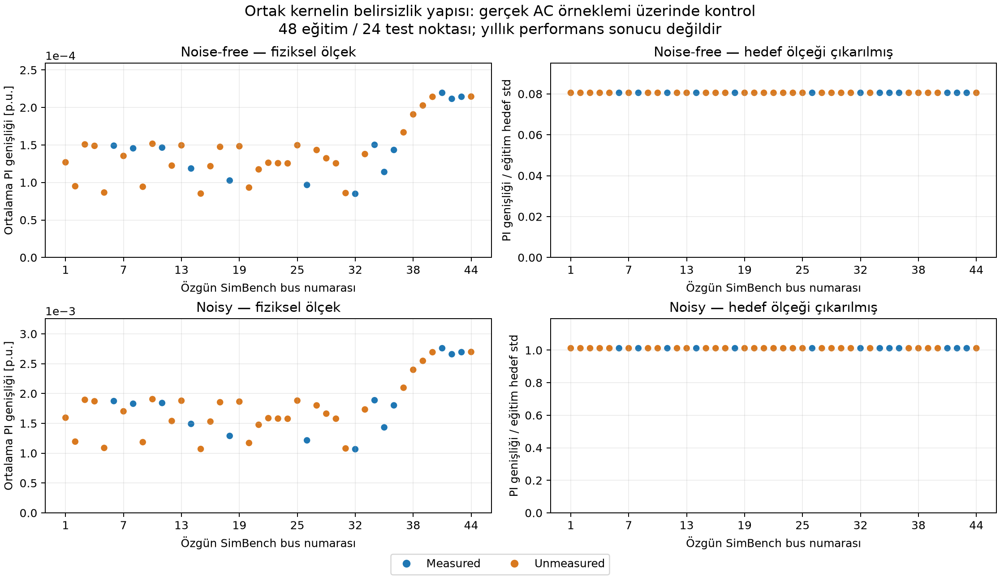

# 1. Mevcut projenin teknik ve bilimsel incelemesi

**Sürüm:** `440f90365c3ed0743139122726f8e737d82000d1` — **23 Ekim 2026**.

## 1.1. Sonuç ve inceleme sınırı

Mevcut çalışma, **seyrek P/Q/V ölçümlerinden bütün non-reference bus'ların gerilim genliklerini kestiren, simülasyon verisi üzerinde sınanmış bir regresyon sistemi** olarak tanımlanmalı. GPR ile state estimation literatürü içinde değerlendirilebilir; ancak tam AC durum vektörünü, fiziksel denklemlere uygunluğu veya dağıtım sisteminde genel gözlenebilirliği çözmüş olduğu söylenemez.

İnceleme üç dayanağa ayrıldı:

- **Koddan doğrulanan davranış:** veri matrisi, split, GPR, çıktı dosyaları, dashboard ve stress akışları.
- **Çalıştırılarak doğrulanan davranış:** mevcut testler, gerçek takvim, 384 AC power-flow adımı, küçük GPR kontrolleri ve bağımsız dayanıklılık denemeleri.
- **Henüz araştırılması gereken hipotez:** yeni yöntemin yıllık doğruluğu, başka feeder'lara genelleme, gürültüye dayanıklılık ve kalibrasyon başarısı.

Depoda kullanıcının yıllık sonuçları yok. Buradaki yıllık örnek sayıları takvim ve split hesabıdır; yıllık performans ölçümü değildir. Geçmiş oturumda yarım kalan değişikliklerin mevcut sürümde bulunduğu varsayılmadı; kaynaklar ve testler yeniden incelendi.

## 1.2. Mevcut deneyin kesin tanımı

| Bileşen | Mevcut uygulama |
|---|---|
| Şebeke | SimBench `1-LV-semiurb4--2-sw` |
| Fiziksel çözüm | pandapower ile dengeli, statik AC power flow |
| Takvim | SimBench'in özgün 2016 yerel saat takvimi; 15 dakika |
| Bus sayısı | 44; bir reference/slack bus |
| Measured bus sayısı | 13; sabit `SENSOR_SEED=42` |
| Girdi | Bu 13 bus'ın P, Q ve V değerleri; toplam 39 özellik |
| Çıktı | 43 non-reference bus için temiz V genliği |
| Birincil kapsam | 30 unmeasured target bus |
| İkincil kapsam | 43 target bus; measured olanlar dahil |
| Ana model | Her mevsim için bir sklearn çok çıktılı GPR; toplam dört nesne |
| Alternatif model | Yalnız Winter için 43 ayrı tek çıktılı GPR |
| Kernel | `ConstantKernel × isotropic RBF + WhiteKernel` |
| Ölçekleme | Eğitim X üzerinde `StandardScaler`; Y için `normalize_y=True` |
| Optimizasyon | Marginal likelihood; sıfır ilave restart; convergence uyarıları bastırılıyor |
| Aralık | Ham GPR standart sapmasıyla `μ ± 1.96 σ` |
| İki ana senaryo | Temiz eğitim/temiz test; noisy eğitim/noisy test |

13/44 = **%29,545455**; non-reference bus'lar esas alınırsa 13/43 = **%30,232558**. `%30 measured` deneyin nominal oranıdır; tezde gerçek sayılar da verilmelidir.

İç bus indeksleri `[2,3,8,15,22,25,27,31,32,35,40,41,42]` seçiliyor. Bunlar kod içi indekslerdir; tez ve sunumlarda kaydedilmiş özgün SimBench isim/numara eşlemesi kullanılmalıdır.

| Mevsim | Eğitim günü | Test günü | Eğitim timestep | Test timestep |
|---|---:|---:|---:|---:|
| Winter | 30 | 61 | 2.880 | 5.856 |
| Spring | 30 | 62 | 2.880 | 5.948 |
| Summer | 30 | 62 | 2.880 | 5.952 |
| Autumn | 30 | 61 | 2.884 | 5.856 |
| Toplam | 120 | 246 | 11.524 | 23.612 |

Day 87 ilkbahar DST günüdür ve testtedir. Day 304 sonbahar DST günüdür ve mevcut deterministic split'te **eğitimdedir**. Bu nedenle gerçek takvimde 100 timestep olduğunu doğrulamak, mevcut yıllık deneyde 100 timestep'lik bir test gününün değerlendirildiği anlamına gelmez. Mevcut kontrollü dashboard testleri bu günü ayrıca sınar.

## 1.3. Dosyaların sorumlulukları ve tez açısından anlamları

| Dosya | Sorumluluk | Değerlendirme |
|---|---|---|
| `config.py` | Şebeke, ölçüm, split, kernel ve noise sabitleri | Deneyin ana tanımı anlaşılır; koşu çıktısına bütün sabitler aktarılmıyor |
| `dsse.py` | Kimlik, takvim, PF cache, veri matrisi, noise, GPR, metrikler | Bilimsel çekirdek; model/uncertainty yorumlarının büyük kısmı burada belirleniyor |
| `seasonal_evaluation.py` | Dört mevsimlik eğitim ve bütün kalan günlerin değerlendirmesi | Doğru pooled accumulation ve ayrı evaluation scope'ları mevcut |
| `seasonal_evaluation_noise_free.py` | Mevcut cache'i kullanan temiz deney ve kendi stress akışı | Clean/noisy ayrımı açık; uzun orchestration kopyaları ileride davranış farkı riski taşır |
| `winter_independent_evaluation.py` | Bus başına ayrı model, manifest ve ayrı koşu klasörü | Ana deneye karışmayan yararlı kontrol; yalnız Winter için geçerli |
| `stress_analysis.py` | Dört fiziksel uç olay, modelden tahmin, seen/unseen grupları | Uç durum teşhisi sağlar; ayrı dağılım ve sistematik robustness testi değildir |
| `kernel_diagnostics.py` | Kaydedilmiş signal-kernel matrisleri ve karşılaştırmalar | Prior/kernel similarity gösterir; posterior cross-bus covariance göstermez |
| `dashboard.py` | Sonuçları yükleme, doğrulama, tablo ve görseller | Veri eşlemesi için güçlü korumalar var; bilimsel genelleme kanıtı yerine geçmez |
| `tests/test_dashboard_heatmaps.py` | Takvim, grid, kimlik, coverage, scope, recovery ve noisy overlay testleri | 17 test ve 22 alt kontrol geçti; modelin yıllık kalibrasyon testi değildir |

## 1.4. Korunması gereken doğru uygulamalar

1. **Theta girdi değildir.** `STATE_COLUMNS` içinde tutulması fiziksel cache içindir; X yalnız `MEASUREMENTS=[P,Q,V]` kullanıyor. Gerçek PF örnekleminde theta'yı bütünüyle değiştirerek X ve V hedeflerinin değişmediği doğrulandı. Kodda theta'nın bulunmasını otomatik sızıntı olarak yorumlamak yanlış olur.
2. **Temiz hedef ve noisy girdi ayrımı doğru.** İki senaryoda da Y temiz V değeridir. Bu, input noise etkisini incelemek için anlamlı bir başlangıçtır.
3. **Scaler testten öğrenmiyor.** `fit_transform` eğitimde, `transform` testte uygulanıyor.
4. **Whole-day split ve train/test kesişimsizliği mevcut.** Aynı günün satırları eğitim ve teste rastgele bölünmüyor.
5. **Takvim gerçek SimBench takvimidir.** Sonbaharda tekrar eden saatler ayrı `simbench_step` kimlikleriyle korunuyor.
6. **Bus kimlikleri korunuyor.** İndeks ile özgün SimBench adını karıştırmamak için ayrı kayıt ve kontroller var.
7. **Pooled RMSE doğru toplanıyor.** Önce squared-error toplamı ve örnek sayısı birikiyor, en sonda karekök alınıyor; günlük RMSE'lerin basit ortalaması pooled RMSE diye sunulmuyor.
8. **Measured bus'ların etkisi birincil metriği kirletmiyor.** Unmeasured-only sonuçlar ayrı hesaplanıyor.
9. **43 ayrı model gerçekten ayrı fit ediliyor.** Her bus için `Y[[column]]` ile farklı `DSSEGaussianProcess` oluşturuluyor. Ortak helper'ın terminale `multi-output` yazması matematiksel olarak yeniden çok çıktılı fit edildiği anlamına gelmiyor.
10. **Dashboard doğrulaması önemli ölçüde geliştirilmiş.** Tam bus×timestep grid, kimlik, takvim, interval sınırları ve kaydedilmiş metrikler için kontroller var. Measured bus çizgisindeki noisy V noktaları, tahminleri yeniden üretme kontrolüyle ilişkilendiriliyor.

## 1.5. Öncelik sırası

| Öncelik | Konu | Gereken iş |
|---|---|---|
| P0 | Tez iddiası ve modelin matematiksel tanımı | V-only kapsam, ortak kernel ve korelasyon ayrımını kesinleştirmek |
| P0 | Değerlendirme tasarımı | Güçlü baseline, ayrılmış validation/calibration/test ve adil Winter karşılaştırması |
| P0 | Belirsizlik | Aralığın estimand'ını tanımlamak; calibration ve proper scoring eklemek |
| P0 | Stress noise tutarlılığı | Aynı olayda günlük/stress inputlarının aynı realization olup olmayacağını açıklaştırmak ve düzeltmek |
| P1 | Measured/unmeasured çıkarımı | Birden çok yerleşim ve aynı bus üzerinde rol değişimi |
| P1 | Tek yıl/feeder ve gerçekçi hata modeli | Topoloji/parametre/gürültü değişimi ve ikinci feeder |
| P1 | Deneylerin tekrar üretilebilirliği | Tam config, hash, sürüm, immutable koşu klasörü ve warning kaydı |
| P2 | Ölçeklenebilirlik ve görsel standardı | Hesap maliyeti, sabit renk ölçekleri ve fiziksel graf doğruluğu |

P0, mevcut yıllık sayılarının yanlış olduğu anlamına gelmez. Bir tezde bu sayılardan güçlü sonuç çıkarabilmek için önce tamamlanması gereken işlerdir.

## 1.6. F01 — Tam durum kestirimi ile V genliği kestirimi ayrılmalı

**Durum: kapsam sınırı; hata değil.** Mevcut hedef yalnız V'dir. AC durum vektörü geleneksel olarak gerilim genlikleri ve referansa göre faz açılarını içerir. Burada 43 V tahmin etmek, 43 açı dahil 86 bilinmeyenli tam durumu kestirmekle aynı görev değildir.

Tez başlığında “distribution system voltage estimation” veya “voltage-magnitude state estimation” kullanılabilir. Tam AC DSSE iddiası istenirse açılar ölçülmeden latent değişken veya ek hedef olarak modellenebilir. **Theta'yı hedef/latent değişken yapmak, theta'yı measured input yapmak değildir.** Kullanıcının mevcut giriş kısıtı korunabilir.

Sadece V varken bütün AC güç dengesi residual'ı hesaplanamaz. Tahmin edilmemiş açılarda test ground truth kullanarak fiziksel residual hesaplamak, işletmede mevcut olmayan bilgiyle sonucu güçlendirir; bu ancak açıkça etiketlenmiş oracle tanı testi olabilir.

## 1.7. F02 — Az ölçümle öğrenmek, fiziksel gözlenebilirlik kanıtı değildir

**Durum: yöntemsel sınır.** 39 P/Q/V ölçümü, tek başına 86 AC durum bilinmeyeni için genel tam-rank gözlenebilirlik sağlamaz. GPR, eğitim dağılımından öğrenilmiş ilişkilerle eksik bilgiyi tamamlıyor. Bu özellik faydalıdır, fakat “%30 sensörle sistem gözlenebilir oldu” denmemelidir.

Şebeke modelinin bilinmesi, zero-injection bilgisi, pseudo-measurement veya başka kısıtlar ölçüm modeline eklenebilir. Bunlar kullanılırsa gerçek measurement Jacobian'ın rank/conditioning analizi ayrıca yapılmalıdır. Mevcut sayı karşılaştırması bu ek bilgilerin yokluğunda sınırı gösterir; her olası fiziksel kurulum için gözlenemezlik ispatı değildir.

**Gerekli adım:** `z=h(x)+ε` ölçüm modeli, bilinen reference koşulları ve kullanılan ek önseller tezde açık yazılmalı [R04].

## 1.8. F03 — Measured bus için temiz V zaten input'ta

**Durum: görev yapısının sonucu.** Noise-free durumda measured bus j için `X_j,V = Y_j,V`. Bu bus için “ölçülen V'yi doğrudan çıktı kabul et” baseline'ı tam sıfır hata verir. Gerçek PF alt örnekleminde de measured identity MAE = **0** bulundu.

Bu, unmeasured bus sonuçlarının sızdığı anlamına gelmez. Aynı anda mevcut measured V'nin kullanılması görev tanımının parçasıdır. Ancak measured-target GPR başarısı, unmeasured-target kestirimiyle aynı zorlukta bir sonuç değildir.

Noisy durumda aynı baseline, noisy V'yi temiz V kestirimi olarak kullanır; GPR bunu denoise edebilir. Bu nedenle measured bus için hem input ölçüm hatası hem GPR'nin bu ölçüme göre iyileşmesi raporlanmalı. P/Q-only ile P/Q/V ablation, V bilgisinin ne kadar katkı verdiğini ayrıca gösterebilir; mevcut ana senaryo değiştirilmeden ayrı deney olmalıdır.

## 1.9. F04 — Ortak modelde ortak posterior mean yok; ortak normalize varyans şekli var

**Durum: matematiksel olarak ve deneyle doğrulandı.** sklearn çok çıktılı GPR, burada aynı kernel hiperparametrelerini kullanan koşullu bağımsız output süreçleri hesaplıyor. Her bus'ın normalize edilmiş eğitim hedef vektörü farklıdır; dolayısıyla posterior mean `μ_j(x)` farklıdır.

Sabit optimize edilmiş kernel için:

```text
A = K_signal(X,X) + (σ_white² + α) I
μ_j(x) = ȳ_j + s_j k(x,X) A⁻¹ y_normalized,j
v_obs(x) = k_signal(x,x) + σ_white² − k(x,X) A⁻¹ k(X,x)
σ_j(x) = s_j sqrt(v_obs(x))
```

Burada `s_j`, eğitim Y'sinin bus j için standart sapmasıdır; constant-target durumunda sklearn'in sıfır standart sapma koruması uygulanır. Mean'ler farklıdır, fakat `σ_j(x)/s_j` bütün bus'larda aynıdır. Yani normalize varyans, X ve tek ortak kernel tarafından belirlenir.

**Kontrol:** gerçek AC alt örnekleminde çıktıların normalize std farkı temiz deneyde yaklaşık `6,94×10⁻¹⁸`, noisy deneyde `1,11×10⁻¹⁶` çıktı. Cholesky faktöründen elle hesaplanan predictive variance ile `predict` sonucu da yaklaşık `10⁻¹⁷` düzeyinde uyuştu.

Bu nedenle aynı mevsimde PI-width matrisi, bus×timestep düzeninde ideal aritmetikte rank 1'dir:

```text
W[j,t] = 3.92 s_j sqrt(v_obs(x_t)).
```

Heatmap'teki bus bantları bu modelde hatalı bir gösterim değildir; modelin sınırlı belirsizlik yapısının doğrudan sonucudur. Yeni modelde bu şeklin değişmesi tek başına başarım kanıtı değildir; coverage ve proper score ile değerlendirilmelidir.

## 1.10. F05 — Measured grubun PI ortalamasının daha yüksek olması nasıl açıklanır?

**Durum: mevcut ortak model için kesin cebirsel sonuç.** Her bus aynı timestep kümesinde değerlendirildiğinde, bir mevsimde:

```text
mean_width_measured / mean_width_unmeasured
    = mean(s_j | measured) / mean(s_j | unmeasured).
```

Dolayısıyla mevcut kurulumda grup oranı, eğitim V değişkenliklerinin oranıdır. Kontrol örnekleminde iki taraftan da **1,0635136934** bulundu; aynı Y eğitim hedefleri kullanıldığı için temiz ve noisy örnekte grup oranı aynı kaldı. Bu değer kullanıcının yıllık oranı değildir.

Unmeasured bus sayısının 30, measured sayısının 13 olması marginal likelihood'ta daha çok unmeasured output terimi bulunması anlamına gelir; optimize edilen ortak parametreleri etkileyebilir. Fakat bu, mevcut PI grup oranının ana matematiksel açıklaması değildir. Ayrıca grup ortalamaları kendi grup sayısına bölündüğünden, fazla sayıda bus olması tek başına grup ortalamasını büyütmez veya küçültmez.

**Öneri:** raw PI width yanında `σ_j/s_j`, bus başına eğitim V std, hata/std ve coverage gösterilmeli. Mevsimler topluca birleştirildiğinde farklı mevsim kernel'ları nedeniyle basit tek-std oranı formülü doğrudan kullanılmamalı; önce mevsim bazında analiz yapılmalı.



*Şekil: gerçek AC örnekleminde hedef ölçeği çıkarıldığında ortak modelin bus'lar arasında aynı belirsizlik şeklini verdiğini gösteren kontrol. 48 eğitim ve 24 test noktası; yıllık sonuç değildir.*

## 1.11. F06 — 43 bağımsız GPR rol farkını gösterebilir; bunu garanti etmez

**Durum: kod doğrulandı, üstünlük hipotezi açık.** Her modelin kendi amplitude, length-scale ve WhiteKernel parametresi var. Bu nedenle hedef ölçeği çıkarıldığında bile standart sapma bus'a göre değişebilir. Shared modelin üç parametresine karşılık Winter independent deneyinde 43×3 = 129 kernel parametresi optimize ediliyor.

Ama bu modeller measured/unmeasured etiketini ayrı bir fiziksel observation operator olarak kullanmıyor. Measured bus'ın kendi V'si input'ta bulunduğundan hedefe özel öğrenilen ilişki rolü dolaylı biçimde yansıtabilir. Bu, label'a göre koşullandırılmış fiziksel posterior ile aynı şey değildir.

Karşılaştırma yalnız Winter'da, aynı train/test günleri, sensörler, noise realization, target bus'lar ve metriklerle yapılmalı. Yıllık dört-model pooled sonuç ile yalnız Winter'ın 43-model sonucu karşılaştırılamaz. Daha dar interval başarım sayılmamalı; yanlış daralma düşük coverage üretebilir.

## 1.12. F07 — WhiteKernel input measurement noise modeli değildir

**Durum: model varsayımı.** P/Q/V gürültüsü X'e ekleniyor, fakat sklearn GPR bu X konumlarını kesin değerler gibi kabul ediyor. WhiteKernel ise normalize output alanında iid residual/observation variance tanımlıyor. `alpha=1e-10` ayrı numerical jitter.

Şu üç şey birbirinden ayrılmalı:

1. sensörün P/Q/V belirsizliği, yani input uncertainty;
2. eksik ölçümler, model hatası ve unresolved variation nedeniyle conditional output residual;
3. kernel hiperparametreleri veya model seçimine ilişkin epistemic uncertainty.

Mevcut yöntem birincisini fiziksel olarak propagate etmiyor; ikincisini tek WhiteKernel ile yaklaştırıyor; üçüncüsünü point-estimate hiperparametrelerle tam integrate etmiyor. Bu kötü bir baseline olduğu anlamına gelmez; ancak “ölçüm gürültüsünü Bayesian olarak tam modelledik” denmemeli [R05, R11].

`predict(return_std=True)` WhiteKernel diagonal katkısını içeriyor. Öngörülen latent smooth function aralığı istenirse bu katkı ayrı ele alınmalı. Fakat hedef temiz fiziksel V olduğunda, ölçülmeyen değişkenlerin yarattığı gerçek conditional variation da mevcut olabilir; “temiz hedef var, WhiteKernel'in tamamını çıkaralım” kararı otomatik doğru değildir. Önce kestirilen dağılım tanımlanmalıdır.

## 1.13. F08 — %95 etiketli aralık, doğrulanmış %95 kapsama değildir

**Durum: zorunlu bilimsel değerlendirme eksiği.** Ham `μ±1.96σ`, varsayılan Gaussian predictive distribution altında nominal aralıktır. Kalibrasyon başarısı ayrıca ölçülmelidir.

Tek pooled coverage yeterli değildir. Measured ve unmeasured gruplar, bus'lar, mevsimler, gündüz/gece, yüksek PV/yük ve noise seviyeleri ayrı incelenmeli. Toplamda %95 görünen bir model bazı bus'larda %60, bazılarında %100 coverage verebilir.

Gerekli ekler: %50/%80/%90/%95/%99 reliability curve; standardized residual/PIT kontrolü; Gaussian NLPD, CRPS veya interval score; coverage'a karşı width; ayrılmış calibration verisi [R15–R19]. Intervali genişleterek coverage yükseltmek tek başına yeterli değildir.

Mevcut aralıklar **marginal**, bus başına/timestep başına aralıklardır. “43 bus'ın tamamı aynı anda %95 güvenle içeride” anlamına gelmez. Bağımsızlık varsayımı altında örnek olarak `0.95^43≈0.110` olur; gerçek bus korelasyonuyla bu sayı değişir. Bu örnek, mevcut modelin gerçek joint coverage'ı olarak sunulmamalıdır.

## 1.14. F09 — Measured/unmeasured karşılaştırması tek sensör yerleşiminde nedensel değil

**Durum: deneysel confounding.** İki gruptaki bus'lar aynı değildir. Şebeke üzerindeki yer, feeder sonuna uzaklık, yük/PV profili, hedef V değişkenliği ve training dağılımı da değişiyor.

Sabit tek yerleşimde `mean_PI_measured > mean_PI_unmeasured` görmek, ölçülüyor olmanın belirsizliği artırdığını kanıtlamaz. Independent modelde tersini görmek de tek başına measured olmanın etkisini kanıtlamaz.

Gerekli düzen: sabit 13 sensör bütçesiyle birden çok yerleşim; mümkün olduğunca aynı bus'ın bazı koşularda measured, bazılarında unmeasured olması; sonuçların bus içinde eşleştirilmesi. Ayrıca mevcut ölçüm kümesine yalnız bir V ölçümü eklenen ayrı deney, sabit Gaussian prior altında variance reduction ilkesini doğrudan sınar. Sabit bütçeyle sensör takası ile yeni sensör eklemek aynı deney değildir.

## 1.15. F10 — Mevcut split retrospective interpolation için uygun; ileri dönem kanıtı değil

**Durum: kapsam ve bağımlılık sınırı.** Günler kesişmiyor; otomatik bir train/test leakage bulgusu yok. Ancak her mevsimin tamamına dağıtılmış eğitim günleri kullanılıyor. 246 test gününün **231'i**, bir eğitim gününe en fazla bir takvim günü uzaklıkta. Winter eğitimi yılın hem başını hem Aralık bölümünü içeriyor.

Bu, mevcut aynı-yıl retrospective reconstruction görevi için meşru bir tasarımdır. State estimation, forecasting ile aynı şey değildir. Fakat gelecekte görülmemiş dönem, sezon dışı işletme veya regime shift başarısı olarak yorumlanamaz [R20].

İkinci değerlendirme hattı: ileri zaman blokları veya rolling-origin değerlendirme; train/test yakınlığı için gap duyarlılığı; mümkünse yeni yıl/profil ailesi. Mevcut benchmark korunmalı ve yeni görev ayrı etiketlenmelidir.

## 1.16. F11 — Ayrı validation ve calibration ayrımı yok

**Durum: tez değerlendirmesinde P0.** Kod hyperparameter fitting'i eğitim verisinde yapıyor; bu doğru. Fakat kernel ailesi seçimi, noise tasarımı ve sonraki modellerin seçimi için ayrı bir dış validation protokolü görünmüyor. Dashboard'dan defalarca sonuç görerek seçilen yöntemin aynı test üzerinde üstünlüğünü ilan etmek, test adaptasyonu riski taşır.

Öneri: model ailesi/hyperparameter seçimleri için eğitim günleri içinde blocked inner validation; interval calibration için ayrılmış günler; son değerlendirme için dondurulmuş test günleri. Mevcut 246 gün geçmiş benchmark olarak saklanabilir. Yeni calibration nedeniyle daha küçük final test kümesi kullanılırsa bütün baseline'lar aynı yeni kümede yeniden değerlendirilmelidir.

## 1.17. F12 — Noise-free/noisy iki kol farklı soruları aynı anda değiştiriyor

**Durum: deney kapsamı.** Mevcut iki kol anlamlıdır: temiz koşulda eğitim ve test; noisy koşulda eğitim ve test. Fakat gürültünün eğitimde öğrenmeyi bozması ile işletmede girdiyi bozması ayrılamıyor.

Genişletme: clean→clean, clean→noisy, noisy→noisy ve noisy→farklı-noise koşulları. Aynı test input realization bütün yöntemlere verilmeli. Ek noise-aware model, mevcut noisy-trained modele rastgele input perturbation ekleyerek tanımlanmamalı; böyle bir yaklaşım noise'u iki kere sayabilir.

## 1.18. F13 — Noise sayıları ve varsayımları doğru adlandırılmalı

**Durum: fiziksel varsayım ve raporlama.** P/Q için bir standart sapma `|değer|×0.01/3`, V için `|değer|×0.005/3` olarak tanımlı. Yani yaklaşık %0,333333 P/Q ve %0,166667 V bir-sigma seviyesidir; %1 ve %0,5 burada üç-sigma referansıdır. Gaussian noise sınırsız olduğundan bunlar kesin hata sınırı değildir.

P/Q için `1e-6 MW/Mvar` alt floor var. V floor'u aynı biçimde uygulanmıyor. P/Q/V hataları bağımsız, sıfır ortalamalı ve anlık Gaussian olarak üretiliyor. Sabit bias, ortak sensör hatası, temporal correlation, gross error, dropout ve asenkronluk yok.

Bu sade varsayımlar baseline için uygun olabilir. Tezde saha sensör davranışının tamamını temsil ettikleri söylenmemeli. Non-Gaussian ve üç-faz DSSE literatürü bu konuda önemli karşı örnek sunuyor [R23].

## 1.19. F14 — Stress analizinde günlük noise realization korunmuyor

**Durum: mevcut iki noisy stress yolunda çalıştırılarak doğrulanan tutarlılık sorunu.** `stress_analysis.prepare_stress_inputs`, önce dört olayın timestep'lerini seçip sonra noise ekliyor. Winter stress akışı da seçilmiş adımları `measurement_inputs` içine veriyor.

RNG, her sütun için dizinin uzunluğu kadar sayı tüketiyor. Aynı day-specific seed'e rağmen “96 satırlık tam günün 48'inci satırı” ile “tek satırlık alt kümenin ilk satırı” aynı rastgele sayıyı almıyor; sonraki sütunların draw konumları da değişiyor.

Gerçek örnekte day 2 / `simbench_step=144` için **39 özelliğin 39'u** farklı realization aldı. En büyük V input farkı yaklaşık **0,005002 p.u.** çıktı. Bu, kullanıcının annual stress sayılarının ne kadar değişeceğinin ölçümü değildir; input tutarsızlığını gösteren kontrollü örnektir.

Bu durum stress deneyini başlı başına geçersiz kılmaz: farklı bir noise realization olarak tanımlanabilir. Fakat aynı olayın günlük sonucu ile stress sonucu aynı model ve seed altında birebir karşılaştırılacaksa yanlış beklenti yaratır.

**En küçük düzeltme:** her olayın ait olduğu bütün gün için noise üretmek, ardından stress adımlarını seçmek. Alternatif: `(seed, gün, özellik, fiziksel timestep)` anahtarlı noise üretimi; bu daha genel bir tasarım değişikliği olur. Sonrasında eski noisy stress çıktıları yeniden hesaplanıp sürümlenmelidir. Bu incelemede uygulama dosyası değiştirilmedi.

## 1.20. F15 — Dört uç olay sistematik stress testi değildir

**Durum: kapsam sınırı.** En yüksek/düşük yıllık V, en yüksek toplam yük ve net demand seçiliyor. Bunlar yararlı fiziksel olaylardır. `seen_in_training` kaydı ve unseen-case grupları da mevcut.

Yine de dört olaydan bütün OOD/robustness davranışı çıkarılamaz. Aynı timestep birden fazla uç olay olabilir; case bazında pooled metrikte aynı fiziksel olay birden çok kez sayılabilir. Bu olasılık mevcut kod yapısından geliyor; kullanıcının çıktılarında gerçekleştiği doğrulanmadı.

Öneri: önceden tanımlı tail yüzdelikleri, ayrı unseen günler, aynı olaya ait duplicate kayıtların açık yönetimi ve kontrollü yeni fiziksel senaryolar. Test ground truth ile uç olay seçmek offline teşhis için meşrudur; işletmede bu olayın önceden tanınabildiği anlamına gelmez.

## 1.21. F16 — Tek feeder ve dengeli simülasyon genellemeyi sınırlar

**Durum: dış geçerlilik sınırı.** Veriler tek SimBench ağı, tek fiziksel model ve tek profil takviminden geliyor. Dengeli AC çözüm, fazlar arası unbalance, neutral effects ve gerçek saha model hatalarını içermiyor.

En az ikinci bir feeder, başka profil/işletme koşulları ve parametre mismatch deneyi önerilir. Üç fazlı feeder eklemek daha güçlü fakat daha maliyetli bir genişletmedir; çekirdek tezin ön koşulu olmak zorunda değildir. Sonuçlar “dengeli simülasyon sistemlerinde” kapsamıyla savunulabilir [R21–R23].

## 1.22. F17 — Girdi değişkenliği ve ARD yorumu dikkat gerektiriyor

**Durum: örneklemde doğrulandı; yıllık genellemesi yapılmadı.** Dört gerçek PF gününde `bus_2_p_mw`, `bus_2_q_mvar`, `bus_15_p_mw`, `bus_15_q_mvar` sabit sıfırdı. Değişken olan sütunlar arasında mutlak korelasyonu 0,999'u aşan 14 çift bulundu.

Regresyonda bu sabit sütunlar temiz senaryoda ayırıcı bilgi taşımıyor; floor-noise ile yalnız gürültülü boyutlara dönüşebilir. ARD için somut bir motivasyon budur. Ancak fiziksel WLS'de zero-injection bilgisi değerli bir kısıt olabilir. “Sabit P/Q var, fiziksel olarak gereksiz” sonucu çıkarılmamalı.

Noise **scaler'dan önce** eklendiği için bu etki daha belirginleşiyor: küçük floor-noise içeren sütunlara da `StandardScaler` eğitimde yaklaşık birim varyans veriyor. 48-point noisy training kontrolünde bu dört sütunun temiz std'si sıfır, noisy raw std'si yaklaşık `10⁻⁶`, standardized std'si **1** bulundu (`noise_scaling_probe.json`). Isotropic kernel bunları diğer standardized boyutlarla birlikte mesafeye katıyor. Bu bir scaler programlama hatası değil; noise-aware input metric veya ARD için sınanabilir bir model tasarımı gerekçesi. Mevcut girdilerden otomatik sütun kaldırılmadı.

Yüksek korelasyon nedeniyle küçük ARD length-scale tek başına nedensel sensör önemi değildir. Birbirinin yerine geçebilen P/Q/V özellikleri arasında önem bölüşümü restart ve split'e göre değişebilir. Feature ablation ve sıralama stabilitesi gerekir.

## 1.23. F18 — Hyperparameter optimizasyonu teşhisleri kayboluyor

**Durum: koddan doğrulandı.** `n_restarts_optimizer=0`; tek başlangıçtan optimization yapılıyor. `ConvergenceWarning` bastırılıyor. Küçük temiz kontrol modelinde constant upper bound ve WhiteKernel lower bound'a ulaşıldı. Bu bulgu yıllık modellerin optimizer başarısızlığı olduğu anlamına gelmez; sınır etkilerinin kaydedilmesi gerektiğini gösterir.

Öneri: optimize edilen parametreler, bound teması, warning metinleri, objective, başlangıçlar ve fit süresini kaydetmek. ARD'ye geçildiğinde 39 length-scale nedeniyle bu ihtiyaç büyür. Restart sayısı ve tuning bütçesi yöntemler arasında adil veya açık raporlanmış olmalıdır.

## 1.24. F19 — ARD mevcut projede tek satırlık kernel değişikliği değildir

**Durum: kod uyumluluğu riski.** Kernelde `RBF(length_scale=np.ones(39))` kullanmak sklearn tarafında ARD sağlar. Fakat `kernel_summary`, kernel diagnostics ve Winter diagnostics içinde `float(rbf.length_scale)` varsayımı var; length-scale vektörüyle bunlar çalışmaz. Dashboard scalar alanlar bekliyor. Ayrıca daha genel kernel yapıları için `k1.k1/k1.k2/k2` sabit yapısına güveniliyor.

En güvenli yol: mevcut modelleri koruyan bağımsız bir deney dosyası; vector-aware kernel metadata; feature başına length-scale tablosu; yeni run type; ortak veri/metric helper'larını mümkün olduğunca yeniden kullanmak. Önerilen yeni modelin eski run'ları yorumlayan kodu bozması önlenmeli.

## 1.25. F20 — Cache doğrulaması fiziksel ağ değişikliğini yakalamıyor

**Durum: kontrollü metadata denemesiyle doğrulandı.** `_cached_ground_truth_report`, schema, ağ kodu, paket sürümleri, eleman sayıları ve takvim kontrollerini karşılaştırıyor. Fakat line/trafo parametreleri, switch durumu, profil içeriği ve dosya içerik hash'leri yok.

Uygulama çıktılarından ayrı stub dosyalar üzerinde yapılan denemede, line resistance %10 değiştirilmesine rağmen aynı metadata kabul edildi. **Bu, kullanıcının cache'inin yanlış olduğuna dair bulgu değildir.** Topoloji veya fiziksel parametre değiştiren gelecek deneylerin eski cache'i yanlışlıkla kullanabilmesi riskidir.

Öneri: ilgili ağ tabloları, in-service/switch durumları, mutlak profil girdileri, solver seçenekleri ve çıktı dosyaları için deterministik fingerprint; her senaryo için ayrı cache/run identity. `load_ground_truth` docstring'inin “PF çalıştırmaz” ifadesi de call-chain ile tam örtüşmüyor: alt loader cache yoksa `build_full_year_ground_truth` çağırıyor. Gerçekten read-only kullanım için açık bir guard/ayrı API daha güvenlidir.

## 1.26. F21 — Run'lar tam immutable ve tam self-contained değil

**Durum: tekrar üretilebilirlik eksiği.** Ana dört-mevsim koşularının klasör adı belirli sabitlerden türetiliyor ve tekrar koşuda günlük/stress dosyaları silinip modeller aynı yerlere yazılıyor. Noise seviyesi veya seed değiştiğinde bütün bu ayarlar klasör adına yansımıyor. Önceki `run_config.json` kalmışken yarım yeni koşu oluşması da mümkün.

Winter independent akışında timestamp'li yeni klasör ve config'in en son yazılması daha iyi bir örnek. Fakat iki akış da bütün noise değerleri, train/test seed'leri, tam feature/target sırası, kaynak commit'i, bütün dependency sürümleri ve input hash'lerini tek manifestte eksiksiz taşımıyor. Ana dört-model config'inde ölçüm/feature sırası da yeterince açık saklanmıyor.

Öneri: immutable run ID; experiment-specific klasör; tam config snapshot; `COMPLETE` işareti ve atomik finalize; source/dependency/input fingerprint. Dashboard reconstruction'da mevcut global config'e güvenmek yerine kaydedilmiş run config kullanılmalı. Mevcut yeniden üretim kontrolleri faydalı ama tam provenance yerine geçmez.

## 1.27. F22 — Fiziksel graf helper'ı topology değişimi için hazır değil

**Durum: koşullu kusur; mevcut şebekede açık switch yok.** Dashboard `topology_graph`, in-service line'ları ekliyor fakat açık line/trafo switch'lerini bu kenarlardan düşmüyor; yalnız bus-bus switch'lerini ayrıca ele alıyor.

Kontrollü kopyada bir line switch açıldığında pandapower'ın `respect_switches=True` grafı ilgili kenarı çıkarırken dashboard grafı tutmaya devam etti. Mevcut başlangıç ağında açık switch sayısı sıfır; dolayısıyla mevcut haritanın bu nedenle hatalı olduğu söylenmiyor.

Topoloji değişimi veya physics/graph kernel deneyinde bu helper doğrudan fiziksel connectivity kaynağı yapılmamalı. Doğrulanmış pandapower topoloji işlevi veya eşdeğer switch-aware graf kullanılmalı.

## 1.28. F23 — Kernel görselleri posterior belirsizlik haritası değildir

**Durum: yorum sınırı.** Diagnostics, `signal_kernel(X,X')` matrislerini gösteriyor; WhiteKernel ayrı raporlanıyor. Bu seçim operating-point similarity için doğru olabilir.

Ancak `K_test,test`, eğitim verisiyle koşullandırılmış `K_test,test − K_test,train A⁻¹ K_train,test` değildir. Ayrıca bu matrisin eksenleri bus değil, operating point/zaman noktasıdır. Bunu “bus'lar arası posterior covariance” diye sunmak yanlış olur.

Gerçek V farklarıyla kernel benzerliği arasındaki Spearman katsayısı keşifsel bir teşhistir. Pairwise mesafeler bağımsız örnekler değildir; tek katsayı fiziksel doğruluk veya istatistiksel anlamlılık ispatı değildir. Nonlinear physics prior tasarımında tam covariance ve posterior covariance ayrı gösterilmelidir.

## 1.29. F24 — Heatmap veri eşlemesi iyi; renk karşılaştırması hâlâ standartlaştırılmalı

**Durum: mevcut testler geçti, sunum önerisi.** Bus/timestep/pivot/coverage eşlemesi için testler var. Coverage Miss 0/1 ayrımı ve inclusive interval sınırları açık. Mevcut son sürümde bus-wise seçim ve günlük heatmap seçili scope'u izliyor; üstteki all-bus snapshot ise açıkça bütün 43 output'u gösteriyor.

Absolute error ve PI width renk limitleri otomatik. Aynı renk iki model/gün için farklı sayısal değer ifade edebilir. Sunum karşılaştırmalarında ortak sabit limit veya ortak veri aralığı kullanılmalı; maksimumu aşan hücrelerin clipping'i belirtilmeli. Bütün değerlerin sıfır olduğu uç durumda otomatik colorbar'ın davranışı ayrıca kontrol edilmeli. Bu incelemede yeni bir tarayıcı render testi yapılmadığı için güncel tarayıcıda belirli bir colorbar aralığı görüldüğü iddia edilmiyor.

Altı veya sekiz decimal gösterim veri kaydıyla aynı şey değildir. Çok küçük PI'lar için scientific notation, fiziksel birim, model/senaryo/scope/date ve nominal/empirical coverage ayrımı grafikte bulunmalıdır.

## 1.30. F25 — Hesap maliyeti ve kıyaslama adil raporlanmalı

**Durum: uygulama ve ölçek sınırı.** Bir exact GP'nin factorization maliyeti kabaca `O(N³)`, belleği `O(N²)`dir. 43 independent model bu işi tekrarlar. Collection her prediction çağrısında modelleri dosyadan yükleyerek belleği kontrol ediyor; bunun I/O maliyeti var.

Mevcut “prediction time” blokları data loading, metric ve CSV yazmayı da içeriyor. Bu yararlı bir end-to-end süre olabilir; saf GP inference latency diye adlandırılmamalı. Fit, warm/cold model loading, model prediction, çıktı üretimi, model dosya büyüklüğü ve peak RAM ayrı ölçülmeli.

Naif tam ICM uygulamasında 2.880×43 = 123.840 task-sample için dense covariance yalnızca float64 veri olarak yaklaşık **122,7 GB** ister; ek factorization/gradient belleği buna dahil değildir. Bu uyarı zaman×task supervised ICM'nin naif uygulaması içindir; her Corr-GPR veya fiziksel conditioning yönteminin bu matrisi kurması gerektiği anlamına gelmez. Kronecker, düşük rank, inducing-point veya küçük state covariance alternatifleri değerlendirilmeli [R14].

## 1.31. F26 — Çalışan kod ile savunulabilir tez arasında kalan işler

Depoda README, dependency manifest/lock, formal experiment specification ve çekirdek GPR/noise/split için kapsamlı regression suite görünmüyor. Mevcut dashboard testleri değerlidir; fakat farklı yöntemler eklendiğinde ortak metric ve veri sözleşmesini koruyan bilimsel testler de gerekir.

İlk tamamlanacak belgeler: ölçüm ve state tanımı; fiziksel/sensör varsayımları; veri erişilebilirliği; kaynak/sürüm manifesti; train/validation/calibration/test protokolü; baseline listesi; iddia–kanıt eşlemesi. Bunlar model çeşidinden önce gelmelidir.

Gerçek işletmede 30 eğitim gününde bütün 43 bus için temiz hedefin nasıl sağlanacağı da tartışılmalı. Simülasyonla offline etiket üretmek geçerli bir yaklaşımdır; gerçek sahada bu etiketlerin sürekli ölçülmüş olduğu varsayılmamalı. Simulation-to-real farkı, physics prior'ın hatası ve model adaptation bu nedenle tez için güçlü araştırma konularıdır.

## 1.32. Bu aşamada kurulabilecek ve kurulamayacak sonuçlar

**Desteklenebilen:** P/Q/V-only ölçüm matrisi; theta input yokluğu; bir yıllık doğru takvim/split hesabı; ayrı Winter scalar fit akışı; doğru pooled metric formülleri; ortak kernelde normalize varyansın bus'lar arasında aynı olması; belirli stress/cache/topoloji tutarlılık riskleri.

**Henüz desteklenmeyen:** yeni modellerin daha iyi yıllık performansı; 43 independent modelin measured rol etkisini nedensel olarak gösterdiği; nominal aralıkların bütün bus ve koşullarda kalibre olduğu; fiziksel denklemlerin tahminlerde sağlandığı; farklı feeder/topolojide robust veya gerçek zamanlı saha kullanımı için yeterli olunduğu.

Bu sınırların açık yazılması çalışmayı zayıflatmaz. Tezin araştırma sorularını, hangi deneyin neyi kanıtlayacağını belirleyecek kadar kesin hale getirir.
